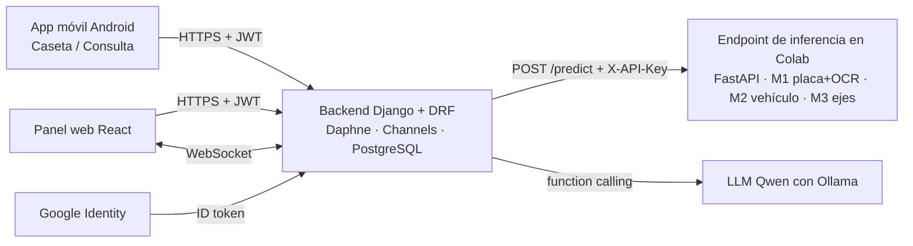

# Arquitectura

Flujo de un paso: el cliente envía un frame; el backend lo reenvía al endpoint; M1 lee la placa, M2 segmenta el vehículo (categoría) y M3 detecta llantas (ejes); el backend calcula la tarifa, guarda el paso, crea la alerta si la placa no está registrada y emite los eventos `paso.nuevo`, `alerta.nueva` y `resumen.actualizado` por WebSocket.

Despliegue: Nginx (HTTPS, Let's Encrypt) sirve el panel compilado y reenvía `/api` y `/ws` a Daphne, administrado por systemd.
